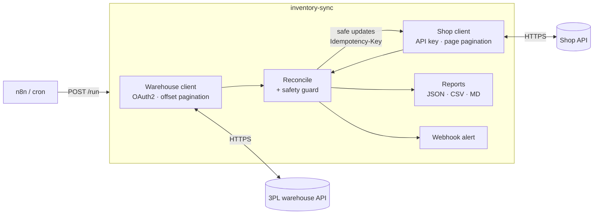

# ecommerce-inventory-sync


Keep an online shop's stock in line with a 3PL warehouse. The tool reconciles both systems, pushes only the safe fixes, and flags everything else for a human.

Stock that drifts between the warehouse and the shop is a classic e-commerce problem. Selling items you no longer have leads to cancellations. Hiding items you do have loses sales. This project shows how to automate the sync in a way you can trust:

- **Fetch** stock from both systems over their APIs.
- **Reconcile** sellable warehouse units against what the shop displays.
- **Auto-fix** small differences, but **hold big or suspicious ones for review**.
- **Report** each run as JSON, CSV and Markdown, and **alert** on Slack or Discord when something needs attention.
- **Schedule** runs with n8n, cron or any HTTP scheduler.

It ships with mock versions of both systems. The mocks rate-limit you, expire your tokens and fail randomly, so the whole flow runs locally in a minute.



## What makes it production-minded

| Problem in real APIs | How it's handled |
|---|---|
| `429 Too Many Requests` and `5xx` errors | Retries with exponential backoff and jitter, and honours `Retry-After` |
| Access tokens expire mid-run | OAuth2 client-credentials token cache refreshes early; on a `401` it refreshes once and replays the request |
| Two systems paginate differently | Offset/limit on one side, page/`next_page` on the other |
| Data changes while you paginate | The row count is checked against the API's `total`. A partial snapshot aborts the run before anything is written |
| Units differ (cartons vs pieces, reserved stock) | Sellable units = `cartons × units_per_carton − reserved` |
| A bad upstream value would wipe out stock | **Safety guard:** a change ≥ `REVIEW_MIN_UNITS` and > `REVIEW_RATIO` × current value goes to review instead of being pushed |
| A retried or re-run job double-applies updates | Each write carries an `Idempotency-Key` built from (day, SKU, target) |
| Someone runs it by accident | **Dry run is the default.** Pushing changes needs `--apply` |
| An alert outage breaks the job | Alert failures are logged and never stop the run |

## Quickstart

```bash
python -m venv .venv && . .venv/bin/activate   # Windows: .venv\Scripts\activate
pip install -e ".[dev]"

# terminal 1: start the mock warehouse + shop
uvicorn mock_systems.app:app --port 9000

# terminal 2: preview, then apply
inventory-sync                 # dry run: writes reports/<timestamp>/, changes nothing
inventory-sync --apply         # pushes the safe updates
```

Or run everything, including n8n, with Docker:

```bash
docker compose up --build
# sync service: http://localhost:8080/docs   ·   n8n: http://localhost:5678
curl -X POST "http://localhost:8080/run?apply=false"
```

## Sample run (dry run against the mocks)

| SKUs | In sync | Mismatch | Missing in shop | Unknown to warehouse | Auto updates | Needs review |
|---:|---:|---:|---:|---:|---:|---:|
| 122 | 77 | 39 | 4 | 2 | 33 | 12 |

| SKU | Warehouse | Shop | Diff | Reason |
|---|---:|---:|---:|---|
| SKU-0035 | 103 | 298 | -195 | change of -195 units exceeds the safety threshold |
| SKU-0037 | 110 | — | +110 | in warehouse but not listed in the shop |
| SKU-0059 | 0 | 120 | -120 | change of -120 units exceeds the safety threshold |
| SKU-9001 | — | 27 | -27 | shop sells stock the warehouse does not have (oversell risk) |

The full report is in [`docs/sample-report.md`](docs/sample-report.md) and the CSV in [`docs/sample-discrepancies.csv`](docs/sample-discrepancies.csv). Running `--apply` pushes the 33 safe updates. A second run then shows `0` auto updates and leaves only the 12 items that need a person.

## Decision rules

| Situation | Status | Action |
|---|---|---|
| Same value in both systems | `in_sync` | none |
| Small difference | `mismatch` | **update** the shop automatically |
| Big jump (absolute **and** relative threshold) | `mismatch` | **review** |
| In the warehouse, not listed in the shop | `missing_in_shop` | **review**, because listing products is a business decision |
| Shop shows stock the warehouse doesn't know | `unknown_to_warehouse` | **review** if the shop value is above 0 (oversell risk) |

## Scheduling with n8n

Import [`n8n/daily-inventory-sync.json`](n8n/daily-inventory-sync.json) in n8n (**Workflows → Import from file**). Then set your own Slack or Discord webhook URL in the last node. The workflow runs:

`Schedule (daily 06:00) → POST /run?apply=true → IF needs_attention > 0 → send alert`

## Configuration

All settings come from environment variables; see [`.env.example`](.env.example).

| Variable | Purpose |
|---|---|
| `WAREHOUSE_BASE_URL`, `WAREHOUSE_CLIENT_ID`, `WAREHOUSE_CLIENT_SECRET` | 3PL API with OAuth2 client credentials |
| `SHOP_BASE_URL`, `SHOP_API_KEY` | Shop API |
| `ALERT_WEBHOOK_URL` | Optional Slack or Discord incoming webhook |
| `REVIEW_RATIO`, `REVIEW_MIN_UNITS` | Safety-guard thresholds |
| `REPORTS_DIR` | Where run reports are written |

## Project layout

```
inventory_sync/
  http.py        resilient client: retries, Retry-After, OAuth2 token refresh
  sources.py     warehouse + shop clients, pagination, completeness check
  reconcile.py   pure decision logic (no I/O)
  pipeline.py    one run: fetch → reconcile → apply → report → alert
  report.py      JSON / CSV / Markdown output
  cli.py         `inventory-sync` command
  service.py     FastAPI `POST /run` for schedulers
mock_systems/    fake 3PL + shop APIs with rate limits, token expiry and random 503s
tests/           16 tests: retry/auth behaviour, decision rules, end-to-end runs
n8n/             importable workflow
```

## Tests

```bash
pytest -q        # 16 passed: runs the real pipeline against the mock systems in-process
ruff check .
```

## Adapting to real systems

`WarehouseClient` and `ShopClient` are the only parts that know about a specific API. To connect a real 3PL or a shop platform (Shopify, WooCommerce and so on), write the same two methods (`fetch_*` and `set_available`) against their endpoints. The retry logic, reconciliation, safety guard, reports and scheduling all stay the same.

---

Built by [Dang Nguyen Giap](https://giapdn-13.github.io), who builds automation and API integrations and is available for freelance work.
